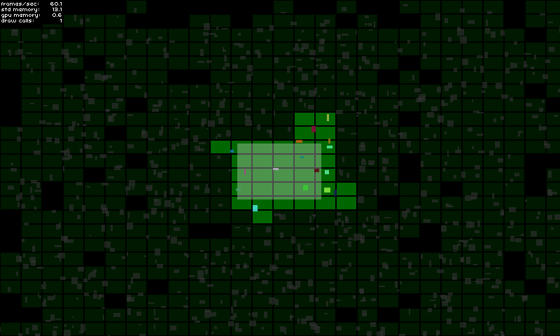

# AS3 / Starling - Spatial Deactivator



This Starling extension is an approach to solve 2D spatial activation / deactivation of game objects. It is meant to take care of showing / hiding game elements that are outside of the screen for example, but not only...
You will be able to basically do whatever you want with a game object when it is considered as active or inactive.

This library could be useful for you if:
- Your game objects could leave a defined active area (camera view for instance) and therefore they need to be deactivated.
- Your game objects could interact with each other and you need to make sure that colliding game objects are "safely" deactivated.

For further details about how it works & why, please have a look at [How it works](doc/HOW-IT-WORKS.md).

## ▶️ Demo

A demo is available in the [demo](demo) folder.

## 😃 How to use it?

### In your ```GameManager```:

```actionscript
private var _deactivator:SpatialDeactivator;
private var _activeAreaAABB:Rectangle = new Rectangle(0, 0, 120, 80);

public function MyGameManager()
{
	// Create the spatial deactivator
	_deactivator = new SpatialDeactivator(_activeAreaAABB.width * 0.25, _activeAreaAABB.height * 0.25);
	Starling.current.juggler.add(_deactivator);
}

// Called at each frame...
public function update():void
{
	// Update active area when needed
	_activeAreaAABB.x = ...; // Your complex stuff here
	_activeAreaAABB.y = ...; // Your complex stuff here
	_activeAreaAABB.width = ...; // Your complex stuff here
	_activeAreaAABB.height = ...; // Your complex stuff here

	// IMPORTANT TIP: Update only if AABB has changed!
	_deactivator.updateActiveArea(_activeAreaAABB);
}

// When unloading a level...
public function clearLevel():void
{
	// Destroys the remaining spatial elements & chunks
	_deactivator.clear();
}

public function get deactivator():SpatialDeactivator
{
	return _deactivator;
}
```

### In your ```GameObject```:

```actionscript
private var _spatialElement:SpatialElement;

public function MyGameObject(gameManager:MyGameManager)
{
	// Setup game object core components
	_mySprite = ...;
	_myPhysicalBody = ...;

	// IMPORTANT: Make sure that the object starts inactive!
	// The deactivator will take care of activating it right away if needed.
	onSpatialElementActivityChanged(false);

	// Create spatial element (an activity bridge, see the API section)
	_spatialElement = new SpatialElement(gameManager.deactivator, true, onSpatialElementActivityChanged);

	// Initial position update
	updatePosition();
}

// Called during frame update...
public function updatePosition():void
{
	// Update game object position & size
	x = ...; // Your complex stuff here
	y = ...; // Your complex stuff here
	width = ...; // Your complex stuff here
	height = ...; // Your complex stuff here

	// IMPORTANT TIP: Update only if AABB has changed!
	_spatialElement.updateAABB(x, y, width, height);
}

private function onSpatialElementActivityChanged(active:Boolean):void
{
	// Activate / deactivate your object as you want.
	_mySprite.visible = active;
	_myPhysicalBody.enable = active;
	...
}

public function destroy():void
{
	// Unregisters the spatial element, without calling its callback
	_spatialElement.destroy();
	...
}
```
**Important notes:**

- Your game objects must start inactive.
- Update spatial elements only when AABB has changed.
- Chunk sizes must be strictly positive. Active areas & AABBs must have finite values and a positive or null size. Invalid values raise an `ArgumentError`.
- The rules of the activity callbacks are detailed in the API section below.

### 🐜 Enabling debug mode

Debug mode will help you to see if you have chosen the right configuration (see important aspects below).

You can enable it simply like this:

```actionscript
_deactivator = new SpatialDeactivator(32, 32, true);

if(_deactivator.debugSprite)
	addChild(_deactivator.debugSprite);
```

It can also be enabled & disabled at runtime. A new debug sprite is created each time it is enabled:

```actionscript
_deactivator.isDebugRenderingEnabled = true;
addChild(_deactivator.debugSprite);

_deactivator.isDebugRenderingEnabled = false; // removes & disposes the debug sprite
```

## 📖 API

### ```SpatialDeactivator```

| Member | Description |
|--------|-------------|
| ```new SpatialDeactivator(chunkWidth, chunkHeight, debugRendering = false)``` | Creates a deactivator dividing the space into chunks of the given size. |
| ```updateActiveArea(area:Rectangle)``` | Sets the area in which elements must be active, usually the camera view. Applied right away, or once ```activeAreaUpdateCooldown``` is over. |
| ```activeAreaUpdateCooldown:Number``` | Minimum time between two active area updates, in seconds (```0.1``` by default). |
| ```advanceTime(time:Number)``` | Applies the pending updates. Called automatically once the deactivator is added to a juggler (```IAnimatable```). |
| ```isEnabled:Boolean``` | Enables or disables the deactivation. While disabled, every element is active. ```isEnable``` is a deprecated alias. |
| ```updateChunksActivity()``` | Forces a refresh of the chunks activity. Does nothing while disabled. |
| ```clear()``` | Destroys the remaining elements (without calling their callbacks) & the chunks, and resets the active area. |
| ```destroy()``` | Clears the deactivator & releases its resources. Remove it from its juggler, it must not be used afterwards. |
| ```isDebugRenderingEnabled:Boolean```, ```debugSprite:Sprite``` | Debug rendering, see the 🐜 section. |
| ```chunkWidth:Number```, ```chunkHeight:Number``` | Size of the chunks (read only). |
| ```chunksCount:int``` | Number of allocated chunks, for monitoring (read only). |
| ```VERSION:String``` | Version of the library (static). |

### ```SpatialElement```

| Member | Description |
|--------|-------------|
| ```new SpatialElement(deactivator, isActivityBridge = true, activityChangedCallback = null)``` | Registers a new element in the deactivator. |
| ```updateAABB(x, y, width, height)``` | Updates the bounding box of the element. Applied right away, or once ```updateCooldown``` is over. |
| ```updateCooldown:Number``` | Minimum time between two bounding box updates, in seconds (```0.1``` by default). |
| ```isActive:Boolean``` | Current activity of the element (read only). |
| ```isActivityBridge:Boolean``` | Whether the element transfers its activity to all the chunks it touches. Static elements should usually not be bridges. Can be changed at any time. |
| ```activityChangedCallback:Function``` | Callback called when the activity changes. Prototype: ```function(isActive:Boolean):void```. |
| ```destroy()``` | Unregisters the element, without calling its callback. Safe to call more than once. |

### Activity callbacks

- A callback is only called when the activity has really changed: an activity changed & restored during the same update is not notified.
- Callbacks are called once the deactivator is up to date, before the call that changed the activity returns, so they can safely create, destroy or move spatial elements.
- A callback set after the creation of an element is called right away if the element is already active, since game objects are assumed to start inactive.
- Callbacks are not called when an element is destroyed or when the deactivator is cleared.

## 📋 Requirements

- Starling 2 (tested with 2.7 & 2.8)
- AIR SDK 33.1 or later (tested with 33.1 & 51.3)

The library, the demo & the tests are built against the Starling version in ```lib```.

## ⌨️ How to install?

Just clone or download the repository and copy/paste the ```src/ch``` folder into your ```src``` directory or add the ```src/``` folder to your class path.

## 🔨 How to build?

The project is set up for Visual Studio Code with the ActionScript & MXML extension.

The AIR SDK path set in the ```.vscode/settings.json``` files (root, ```demo``` & ```test```) is the one of the author: change ```as3mxml.sdk.framework``` to your own AIR SDK path locally, without committing it.

The projects can also be built from a terminal, from the repository root:

```powershell
npx --yes asconfigc --sdk <air-sdk-path> --project asconfig.json       # library (SWC)
npx --yes asconfigc --sdk <air-sdk-path> --project demo/asconfig.json  # demo
```

See [test/README.md](test/README.md) to build & run the tests.


## 💡 Important aspects

### 1. Find the right chunks size

One important point to make this tool efficient for you is to find the correct chunk size to best fit to your needs.

- Too big chunks will cover too much game objects and therefore activate too much of them at the same time.
- Too small chunks will requires a lot of chunks processing for nothing.

You can test & see what's the best for you by enabling the debug mode (see 🐜 section).

I personally use a ratio of ```0.25``` compared to the active area size.

```actionscript
new SpatialDeactivator(_activeAreaAABB.width * 0.25, _activeAreaAABB.height * 0.25);
```

### 2. Find the right active area size

If your active area corresponds to the camera view, using margin could be useful to anticipate activation of upcoming game objects.

```actionscript
private var _margin:Number = 20;
private var _activeAreaAABB:Rectangle = new Rectangle(0, 0, 120 + _margin, 80 + _margin);
...
_activeAreaAABB.x = x - _margin * 0.5;
_activeAreaAABB.y = y - _margin * 0.5;
deactivator.updateActiveArea(_activeAreaAABB);
```

### 3. Find the right spatial element size

The size of a spatial element should cover the entire size of your game object to make sure that the game object doesn't become inactive too early or active too lately.
If needed, the size of your spatial elements can be a bit bigger than your game objects bounds as well:

```actionscript
_spatialElement.updateAABB(x - margin * 0.5, y - margin * 0.5, width + margin, height + margin);
```