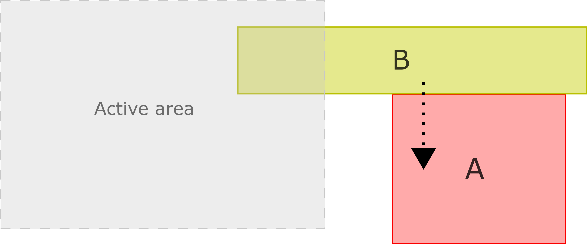
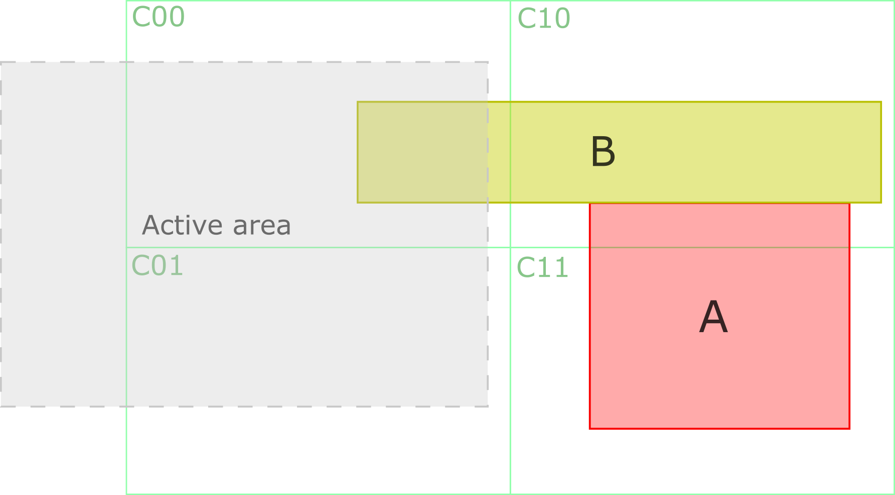
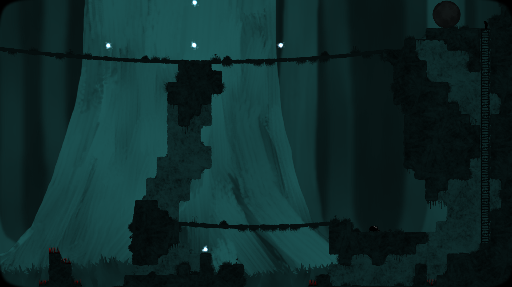
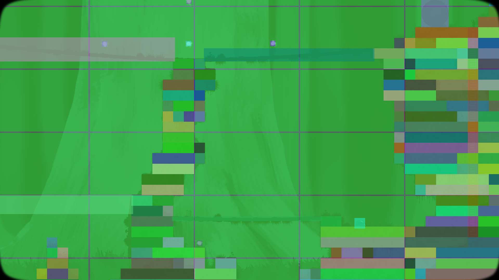

# How the Spatial Deactivator works

An AS3 / Starling module to handle automatic spatial game objects activation & deactivation.

This document explains the approach & its reasons. The usage & the API are detailed in the [README](../README.md).

## The problem

This module is meant to be used for optimization reasons when a lot of living game objects are out of your camera field of view.

A first approach to solve this optimization topic is simply to check whenever an object has moved if it's still colliding the active area - if it doesn't, it obviously needs to be deactivated.

However, a problem arises when objects have a spatial dependency between each other.
For instance, the consistency of the simulation could be easily broken if an object which supports another suddenly becomes inactive.

The following picture illustrates that problem when using the above simple solution with dynamic objects simulated by a physics engine.
Both objects (A & B) are solid. **Object B** is dynamic (subject to gravity) and it is currently supported by **object A**.
When **object A** leaves the active area, it is deactivated and **object B** will unwantedly fall down.



## How does it work?

The space is divided into a regular grid of **spatial chunks** (or cells), and the activity is propagated from the **active area** through the chunks & the **spatial elements** (or game objects) touching them.

### Activity propagation

Basically, a **spatial chunk** is active when it touches directly the **active area**.
When a **spatial element** touches an active **spatial chunk**, it becomes active and, if it is an **activity bridge**, transfers its activity to all the other touched **spatial chunks**.
Through this **activity propagation** mechanism, step by step, all **spatial elements** which could potentially interact with each other are therefore woken up.

Here is how it solves the above issue (chunks are named after their column & row: **C10** is the second column of the first row):



The sequence of the **activity propagation** from the **active area** to the **object A** is:

- First the **active area** will activate the colliding chunks: **C00 chunk** & **C01 chunk**.
- **C00 chunk** will then activate inactive touching objects: **Object B**.
- **Object B** will then activate inactive touching chunks: **C10 chunk**.
- **C10 chunk** will then activate inactive touching objects: **Object A**.
- **Object A** will then activate inactive touching chunks: **C11 chunk**.

Elements which don't need to transfer their activity, static ones for instance, can be created as non-bridges: they are activated by the chunks they touch, but don't activate other chunks.

### Deactivation

When a link may be broken, because the active area moved, an active bridge left chunks out of the active area or a bridge linking chunks was destroyed, the chunks reachable from the active area through the bridges are computed again.
The chunks which are not reachable anymore are deactivated, and so are the elements touching only inactive chunks.

In the above example, **object A** stays active as long as **object B** links it to the active area, and both are deactivated together once the active area doesn't reach them anymore.

Elements are notified of their activity changes once the whole context is up to date, and only when their activity has really changed.

### Spatial chunks

Using a predefined regular grid requires almost no cost to find the cells in which an object is part of (when using **AABB**, Axis-Aligned Bounding Box).
And no need to parse all existing game objects to check the boundaries.
However, each time an object moves, it needs to be registered / unregistered when it respectively enters / leaves chunks.

Chunks are only created where elements are, and freed once they contain no element & are inactive, so the number of chunks follows the elements rather than the places visited by the camera.

### Update delays

For performance reasons, the updates of the active area & of the elements are applied at most every 0.1 seconds by default (the ```activeAreaUpdateCooldown``` & ```updateCooldown``` properties).
The activity can therefore lag slightly behind the movements, which is why the active area should have a [margin](../README.md#2-find-the-right-active-area-size) around the camera view.

> **Note:** this approach is not claimed to be the best one, but it works well in the context of a 2D side-scrolling platform game (see below).
> Improvements can be proposed on the [Starling Forum](https://forum.starling-framework.org/topic/extension-as3-starling-spatial-deactivator).

## Other approaches

In physics engines, special data structures ([Bounding Volume Hierarchy (BVH)](https://en.wikipedia.org/wiki/Bounding_volume_hierarchy)) are commonly used to detect pair-collision or to achieve efficient ray tracing.
A Dynamic AABB Tree, commonly used in physics engines' broad phases, is one of them (here is an [AS3 Dynamic AABB Tree](https://github.com/azrafe7/as3AABBTree) implementation).

Those data structures could be studied for a future version of the library, to see if they are suitable for this particular use case & to compare them with this solution.

## Where is it used?

This library is used in [Looking for Imago](http://looking-for-imago.com/), a 2D side-scrolling platform game.
In that game, this module helps to improve the overall performance by activating & deactivating several aspects (physics, graphics, logic & sounds) of game objects that are outside of the camera field of view.

Here are two pictures that show the library in action:

| Debug mode **off** | Debug mode **on** |
|:---:|:---:|
|  |  |

As you can see, the static **spatial elements** (ground blocks) have been divided in multiple parts in order to avoid several overlaps with the **spatial chunks**.
This trick was used to avoid activity transfer by the ground blocks, which could wake up plenty of **spatial chunks** by overlapping them.

Since then, the **isActivityBridge** flag has been introduced specifically to inhibit activity transfer: static **spatial elements** can simply be created as non-bridges.

## Missing features and/or known issues

- Only one and unique **active area** is possible for the moment. Multiple **active areas** could be useful for multiplayer games.
- Filtering which elements can activate each other (with masks, like collision filtering) could be interesting for some cases.
- The library can easily be generalized to AS3 (by using a sort of debug factory system) because **Starling** is mainly required for debugging purposes.
